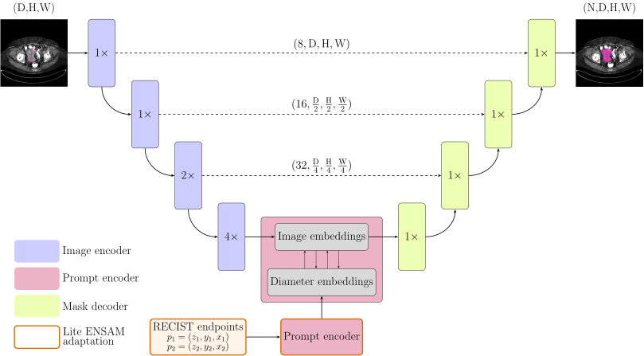
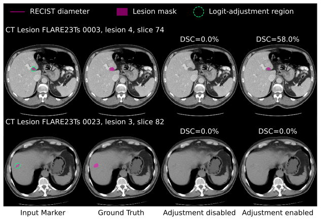

# Lite ENSAM: a lightweight cancer segmentation model for 3D Computed Tomography

[](https://openreview.net/forum?id=Ev0c6zrp9N)     [](https://www.python.org/downloads/release/python-31211/)

Official implementation of [Lite ENSAM](https://openreview.net/forum?id=Ev0c6zrp9N), submitted to [MICCAI FLARE 2025 Task 1: Pan-cancer Segmentation in CT Scans, Subtask 2](https://www.codabench.org/competitions/7149/). This README reflects the revised manuscript.

Lite ENSAM converts RECIST diameter annotations into 3D tumor segmentations. The 1.3-million-parameter model adapts ENSAM for non-interactive inference under the competition's CPU-only limits of **8 GB RAM and 60 s per case**.

## Method

Lite ENSAM retains ENSAM's encoder–decoder and prompt-conditioned attention structure, with reduced network dimensions and an inference voxel budget selected for the competition's resource constraints. The two RECIST endpoints share a learned token embedding; their coordinates are encoded through Lie Rotational Positional Encoding (LieRE). The corresponding model configuration is `ahus_model_rope_mixed`.

A common region of interest encloses the RECIST annotations. Image features are computed once and shared across lesions, and predicted logits are restored to the original CT grid. CPU post-processing optimizations reduce runtime and memory usage. Lesion-presence adjustment increases logits around RECIST annotations for initially missing lesions, with at most three prediction passes.

<div align="center">
  
</div>

*Figure 1. Lite ENSAM architecture. Orange outlines indicate the RECIST-specific extensions to ENSAM.*

## Results

### Segmentation accuracy

| Evaluation cohort | DSC (%) | NSD (%) |
| :--- | :---: | :---: |
| Official hidden test | 60.7 | 63.6 |
| Public validation | 69.7 ± 16.8 | 61.8 ± 19.1 |

Hidden-test scores were supplied by the organizers. Local public-validation results use the available 49 cases with 84 annotated lesions and report means ± sample standard deviations across cases. Evaluation uses per-lesion binary masks and original physical voxel spacing, averaging lesions within cases and then weighting cases equally. Local NSD uses a 2 mm tolerance and is zero for lesions with DSC below 0.2.

<div align="center">
  
</div>

*Figure 2. Public validation examples ordered from higher to lower case-level DSC. DSC values are percentages.*

### Organizer-reported inference efficiency

The organizers measured end-to-end inference on ten public validation cases using their evaluation hardware.

| Mean inference time | Mean peak RAM | Mean RAM-time |
| :---: | :---: | :---: |
| 14.4 s | 4.7 GB | 50.6 GB s |

All ten cases met the per-case runtime and memory limits. These measurements describe the organizer-reported subset.

### CPU post-processing comparison

Table 5 of the paper compares ENSAM's post-processing with Lite ENSAM's optimized implementation using identical logits, RECIST adjustment regions, and stopping rules.

| Implementation | Mean time (s) | Maximum time (s) | Mean peak RSS (GiB) | Maximum peak RSS (GiB) |
| :--- | :---: | :---: | :---: | :---: |
| Baseline | 5.3 | 32.7 | 2.6 | 6.9 |
| Optimized | 0.2 | 1.3 | 1.7 | 4.2 |

The benchmark ran on the development CPU listed below, in CPU-only Docker containers with four threads, an 8 GiB memory limit, and swap disabled. Runtime statistics summarize per-case means of three repetitions after a warm-up pass. Peak resident set size (RSS) is the maximum physical RAM occupied by the complete benchmark process. All paired segmentations were voxel-identical, and all runs completed within the memory limit. These timings measure post-processing only.

### Lesion-presence adjustment

The adjustment was triggered in 7/49 public validation cases (14.3%) and 8/84 lesions (9.5%). Six initially missing lesions obtained nonempty predictions; two remained absent.

| Public validation cohort | DSC without adjustment (%) | DSC with adjustment (%) | NSD without adjustment (%) | NSD with adjustment (%) |
| :--- | :---: | :---: | :---: | :---: |
| Entire set | 67.8 | 69.7 | 59.8 | 61.8 |
| Affected cases | 37.5 | 50.5 | 33.0 | 47.3 |
| Affected lesions | 0.0 | 31.1 | 0.0 | 32.7 |

The first two rows average lesion scores within each case, then weight cases equally; the last row averages the affected lesions directly. Both subsets belong to the public validation set. Individual architectural changes were not ablated; the experiments assess CPU implementation optimizations and lesion-presence adjustment.

<div align="center">
  
</div>

*Figure 3. Recovery of lesion 4 in image 0003 (top) and persistent failure for lesion 3 in image 0023 (bottom). Magenta denotes the RECIST diameter or lesion mask; the dashed green outline marks the logit-adjustment region. DSC describes the complete 3D lesion.*

## Environment and installation

The paper reports the following development environment:

| Component | Specification |
| :--- | :--- |
| Operating system | Debian 12 |
| CPU | Intel Core i9-14900KF |
| RAM | 2 × 48 GB, 4800 MT/s |
| GPU | NVIDIA GeForce RTX 5090, 32 GB |
| CUDA | 12.8 |
| Python | 3.12 |
| Framework | PyTorch 2.7.0, Torchvision 0.22.0 |

From the repository root:

```bash
python3.12 -m venv venv
source venv/bin/activate
python3 -m pip install --upgrade pip
python3 -m pip install -r requirements.txt
```

## Dataset

The [FLARE RECIST-to-3D dataset](https://huggingface.co/datasets/FLARE-MedFM/FLARE-Task1-PancancerRECIST-to-3D) was used for training and validation. Training used the provided labelled data, without external pretraining, additional datasets, or partially labelled and unlabelled data.

Download and organize the dataset:

```bash
python3 download_flare25_task1_subtask2.py
python3 structure_dataset.py --copy
```

The structuring script creates `dataset/FLARE-Task1-PancancerRECIST-to-3D/train/` and `val/`, with cases grouped by modality and source. Omit `--copy` to move the files instead.

## Training and fine-tuning

Train with the paper's 75-epoch, single-GPU configuration:

```bash
python3 -m src.train_ahus_model \
  --train_dir dataset/FLARE-Task1-PancancerRECIST-to-3D/train \
  --val_img_dir dataset/FLARE-Task1-PancancerRECIST-to-3D/val \
  --model_type ahus_model_rope_mixed \
  --checkpoint "" \
  --gpu_ids 0 \
  --num_epochs 75
```

The empty checkpoint argument starts training from scratch. Training prompts are synthesized from transformed lesion masks; inference uses the supplied RECIST markers.

For fine-tuning, organize custom data as `dataset/<name>/{train,val}/<modality>/<source>/<case>.npz`, then run:

```bash
python3 -m src.train_ahus_model \
  --train_dir <training_directory> \
  --val_img_dir <validation_directory> \
  --checkpoint pretrained_models/lite_ensam_flare25.pth \
  --model_type ahus_model_rope_mixed \
  --gpu_ids 0 \
  --num_epochs 75
```

## Inference

Use the supplied checkpoint and a directory containing the challenge-format NPZ files with CT images and RECIST annotations.

The checkpoint is stored in Git LFS. With Git LFS installed, download the weights from the repository root:

```bash
git lfs install
git lfs pull --include="pretrained_models/lite_ensam_flare25.pth"
```

### Local CPU inference

```bash
mkdir -p lite_ensam_outputs
python3 -m src.submission.ahus_predict \
  --load_path <input_directory> \
  --save_path lite_ensam_outputs \
  --model_checkpoint pretrained_models/lite_ensam_flare25.pth \
  --model_type ahus_model_rope_mixed \
  --segmenter_type original \
  --segmenter_device cpu \
  --model_device cpu
```

### Docker inference

```bash
mkdir -p submission_files lite_ensam_outputs
cp pretrained_models/lite_ensam_flare25.pth submission_files/weights.pth
docker build . -t ahus_flare25:latest
docker run --rm --memory 8g --memory-swap 8g \
  -v /absolute/path/to/input:/workspace/inputs:ro \
  -v "$PWD/lite_ensam_outputs:/workspace/outputs" \
  ahus_flare25:latest /bin/bash -c "sh predict.sh"
```

Docker's `8g` setting imposes an 8 GiB memory limit; the matching swap setting disables swap. The competition requirement is stated as 8 GB in the paper.

## Local validation evaluation

The corrected evaluator computes DSC and NSD from separate binary masks for each lesion and uses the original NPZ voxel spacing. It evaluates the saved ZYX predictions produced by this repository (`.nii.gz` or `.npz` with a `segs` array); it does not use the identity affine of exported NIfTI files as physical spacing.

```bash
python3 -m src.scripts.evaluate_recist \
  --inputs <public_validation_npz_directory> \
  --predictions lite_ensam_outputs \
  --output validation_scores.json
```

Reference NPZ files must contain `gts` and `spacing`. The JSON includes per-lesion and per-case scores, dataset means, and sample standard deviations, with scores stored as fractions. Cases are weighted equally. NSD uses a 2 mm tolerance and is zero for lesions with DSC below 0.2. Missing lesions score zero; missing prediction files fail evaluation rather than being omitted. Empty-reference cases are rejected, and prediction-only lesion IDs are ignored. Official hidden-test scores are reported separately from this local protocol.

## License

The repository is licensed under the [Apache License 2.0](LICENSE).

## Acknowledgements

The authors thank all data owners for making the CT scans publicly available and the CodaLab team for providing the Codabench challenge platform. Funding was provided by Novartis Norge AS and Akershus University Hospital.

## Citation

If this repository is useful, please cite the paper:

```bibtex
@inproceedings{bjornstad2025lite,
  title={Lite ENSAM: a lightweight cancer segmentation model for 3D Computed Tomography},
  author={Bj{\o}rnstad, Agnar Martin and Stenhede, Elias and Ranjbar, Arian},
  booktitle={MICCAI 2025 FLARE Challenge},
  year={2025},
  url={https://openreview.net/forum?id=Ev0c6zrp9N}
}
```
